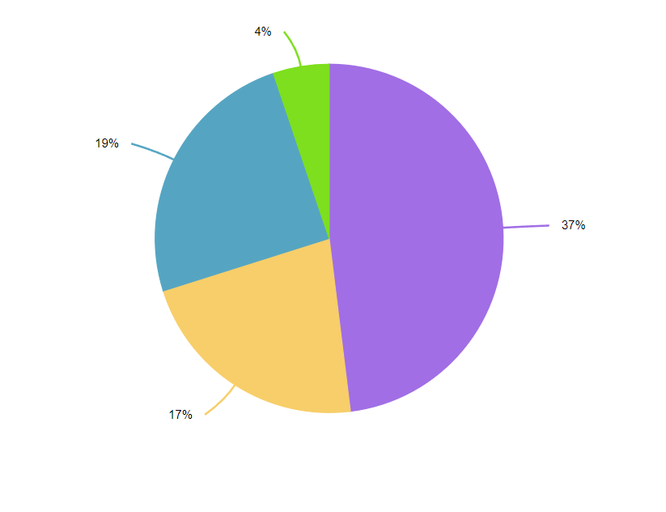

# How to change the data label connector type of pie and doughnut series to Bezier

This article explains how to change the data label connector type of pie and doughnut series in [Blazor Chart](https://www.syncfusion.com/blazor-components/blazor-charts) component.

## Features

* Display data labels in Pie and Doughnut charts.
* Use Bezier curves for data label connectors.
* Improve label readability with smooth connector lines.
* Position labels outside chart segments.
* Customize data label and connector appearance.
* Handle chart layouts with multiple data points effectively.
* Configure connector behavior through chart settings.
* Create visually enhanced chart presentations.

## Prerequisites

- Visual Studio 2026 or Visual Studio Code
- [.NET 10 SDK](https://dotnet.microsoft.com/download/dotnet/10.0)

## How to run the project

**Visual Studio 2026**:

* Checkout this project to a location in your disk.
* Open the project (`ConnectorType.csproj`) file.
* Restore the NuGet packages.
* Run the project.

**Visual Studio Code**:

* Open the repository folder in Visual Studio Code.
* Open the integrated terminal.
* Navigate to the repository root.

```bash
cd How-to-change-the-data-label-connector-type-of-pie-and-doughnut-series-to-Bezier
dotnet restore
dotnet run
```

Open the URL displayed in the terminal after the application starts.

**Changing data label connector type in Blazor Accumulation Chart**

You can change the data marker's connector line type of pie and doughnut series to Bezier using the [Type ](https://help.syncfusion.com/cr/blazor/Syncfusion.Blazor.Charts.AccumulationChartConnector.html#Syncfusion_Blazor_Charts_AccumulationChartConnector_Type)property of pie and doughnut series when the data label is placed [Outside](https://help.syncfusion.com/cr/blazor/Syncfusion.Blazor.Charts.AccumulationLabelPosition.html#Syncfusion_Blazor_Charts_AccumulationLabelPosition_Outside).

The following code snippet and screenshot illustrates this.

**Home.razor**

```cshtml

@using Syncfusion.Blazor.Charts

<SfAccumulationChart>

    <AccumulationChartLegendSettings Visible="false"></AccumulationChartLegendSettings>

    <AccumulationChartSeriesCollection>
        <AccumulationChartSeries DataSource="@StatisticsDetails" XName="Browser" YName="Users" Name="Browser">
            <AccumulationDataLabelSettings Visible="true" Name="Text" Position="AccumulationLabelPosition.Outside">
                <AccumulationChartConnector Color="#f4429e" Length="35px" Width="2" Type="ConnectorType.Curve" ></AccumulationChartConnector>
            </AccumulationDataLabelSettings>
        </AccumulationChartSeries>
    </AccumulationChartSeriesCollection>

</SfAccumulationChart>

@code{

    public class Statistics
    {
        public string Browser { get; set; }
        public double Users { get; set; }
        public string Text { get; set; }
        public string Fill { get; set; }

    }

    public List<Statistics> StatisticsDetails = new List<Statistics>
	{
        new Statistics { Browser = "Chrome", Users = 37, Text= "37%", Fill="#498fff"},
        new Statistics { Browser = "UC Browser", Users = 17, Text= "17%", Fill="#ffa060"},
        new Statistics { Browser = "iPhone", Users = 19, Text= "19%", Fill="#ff68b6"},
        new Statistics { Browser = "Others", Users = 4 , Text= "4%", Fill="#81e2a1"},
    };
}

```

The following screenshot illustrates the output of the above code snippet.

**Output:**



**Conclusion**

We hope you enjoyed learning how to change connector type in accumulation chart of Blazor Chart component.

You can refer to our [Blazor Chart feature tour](https://www.syncfusion.com/blazor-components/blazor-charts) page to know about its other groundbreaking feature representations and [documentation](https://help.syncfusion.com/chart-sdk/blazor/charts/getting-started), and how to quickly get started for configuration specifications. You can also explore our [Blazor Chart example](https://blazor.syncfusion.com/demos/chart/line?theme=fluent2) to understand how to create and manipulate data.

For current customers, you can check out our components from the [License and Downloads](https://www.syncfusion.com/sales/pricing?category=ui-components) page. If you are new to Syncfusion, you can try our 30-day [free trial](https://www.syncfusion.com/downloads/blazor) to check out our other controls.

If you have any queries or require clarifications, please let us know in the comments section below. You can also contact us through our [support forums](https://www.syncfusion.com/forums), [support portal](https://support.syncfusion.com/support/tickets/create), or [feedback portal](https://www.syncfusion.com/feedback/chart-sdk). We are always happy to assist you!